# Cyberbullying Tweet Classification

A comparative study of classical machine learning, BiLSTM, and Transformer-based models for multiclass cyberbullying tweet classification.
The project explores different text preprocessing pipelines, word embedding techniques, and deep learning architectures to classify tweets into six categories of 
cyberbullying.

## Dataset

**Source:** [Kaggle Cyberbullying Tweets Dataset](https://www.kaggle.com/datasets/andrewmvd/cyberbullying-classification)

**Samples:** ~47,000 tweets

**Classes:**
  - Religion
  - Age
  - Ethnicity
  - Gender
  - Other Cyberbullying
  - Not Cyberbullying

## Exploratory Data Analysis

The dataset was analysed before training to better understand its characteristics.

Major analyses include:

- Class distribution
- Duplicate tweet analysis
- Tweet length distribution
- Class-wise tweet length statistics
- Word frequency analysis
- Data cleaning comparison

### Sample Visualisations

#### Class Distribution
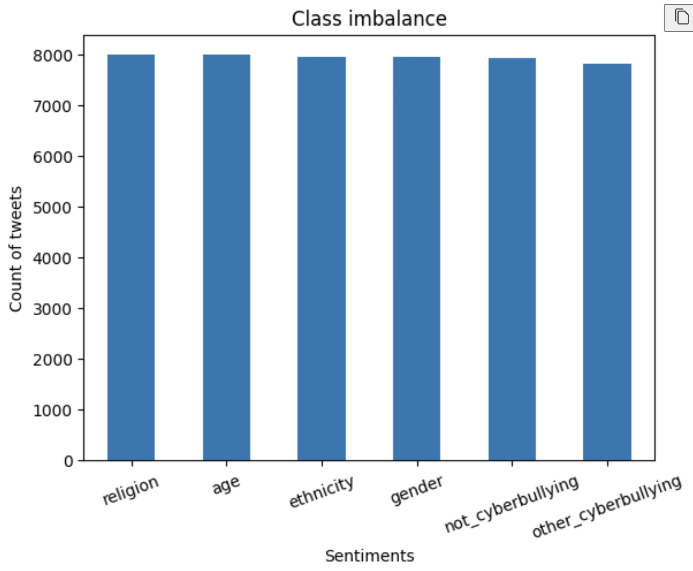

#### Tweet length distribution
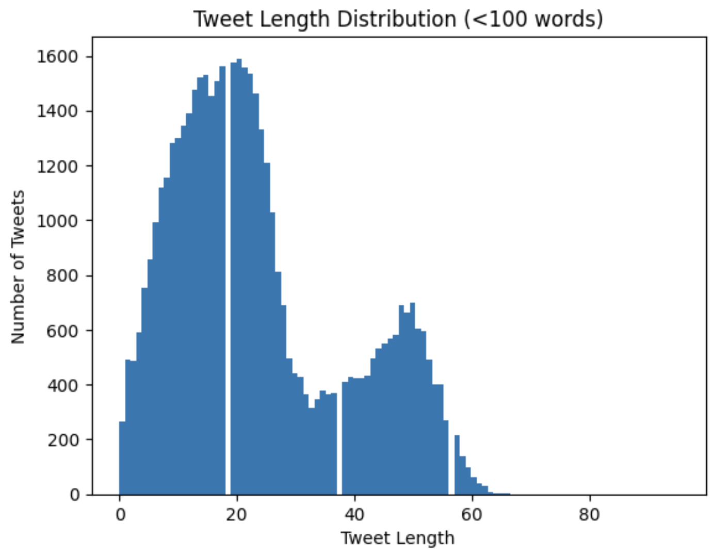 

#### Class-wise tweet length distribution
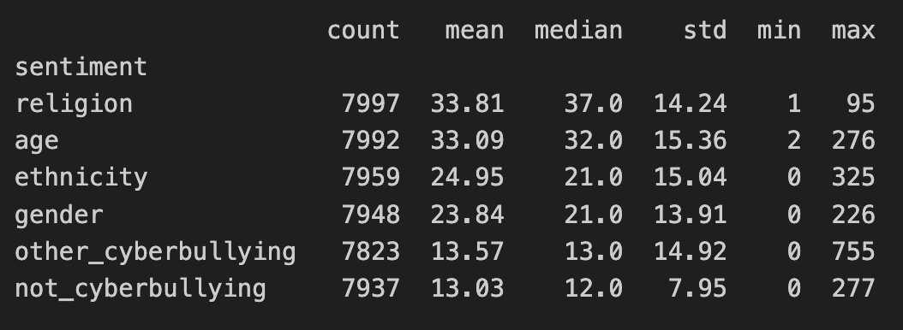 

#### Word frequency analysis
Top 15 words for 'age'
[('school', 8298), ('i', 8239), ('the', 7973), ('in', 6122), ('and', 6121), ('to', 6035), ('a', 5914), ('high', 5081), ('bullied', 4393), ('me', 3910), ('of', 3571), ('was', 3234), ('that', 3145), ('is', 3094), ('you', 2956)]

Top 15 words for 'ethnicity'
[('the', 5544), ('fuck', 5223), ('dumb', 5213), ('you', 4830), ('nigger', 4465), ('a', 4089), ('i', 3954), ('to', 3329), ('is', 3266), ('and', 3149), ('ass', 2280), ('that', 2222), ('not', 2112), ('black', 2107), ('of', 2097)]

Top 15 words for 'gender'
[('a', 5375), ('rape', 4300), ('i', 4221), ('the', 4206), ('is', 4162), ('and', 3887), ('gay', 3877), ('not', 3515), ('jokes', 3455), ('to', 3307), ('you', 2642), ('it', 2259), ('of', 2183), ('that', 2096), ('are', 2072)]

Top 15 words for 'not_cyberbullying'
[('i', 2662), ('the', 2659), ('is', 2268), ('to', 2261), ('a', 1960), ('mkr', 1608), ('and', 1500), ('not', 1491), ('you', 1416), ('of', 1264), ('it', 1174), ('that', 1166), ('in', 1068), ('are', 909), ('for', 796)]

Top 15 words for 'other_cyberbullying'
[('i', 3987), ('is', 2877), ('to', 2592), ('a', 2409), ('the', 2378), ('not', 1920), ('you', 1690), ('it', 1563), ('that', 1495), ('of', 1375), ('and', 1261), ('this', 999), ('in', 981), ('are', 952), ('have', 923)]

Top 15 words for 'religion'
[('the', 8200), ('you', 7096), ('to', 6016), ('is', 5833), ('and', 5802), ('a', 5143), ('of', 4894), ('are', 3938), ('not', 3655), ('in', 3560), ('i', 3014), ('that', 3003), ('it', 2529), ('muslims', 2456), ('muslim', 2398)]

## Text Preprocessing

Different preprocessing pipelines were designed for classical machine learning, BiLSTM, and Transformer models to account for their differing input requirements.

Common preprocessing steps included:

- Lowercasing
- URL and HTML tag removal
- Emoji removal
- Punctuation and special character removal
- Duplicate tweet removal
- Handling empty tweets

### Preprocessing for Classical Machine Learning models

- Text cleaning
- TF-IDF / Bag-of-Words vectorization

### Preprocessing for BiLSTM model

- Text cleaning
- Tokenization
- Vocabulary construction
- Sequence padding
- Pre-trained Word2Vec and GloVe embeddings

### Preprocessing for Transformer model

- Minimal text cleaning
- DistilBERT tokenizer
- Attention masks and input IDs generated by the tokenizer

## Models

### Classical Machine Learning

- Multinomial Naive Bayes
- Logistic Regression

Embeddings:

- Bag of Words
- TF-IDF

### Deep Learning

- BiLSTM

Embeddings:

- Word2Vec (Google News)
- GloVe (6B 300d)

### Transformer

- DistilBERT (`distilbert-base-uncased`)

## Results

### Classical Machine Learning models
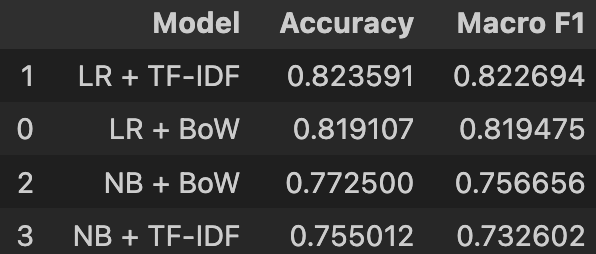

### Deep Learning models (BiLSTM + Glove/Word2Vec)
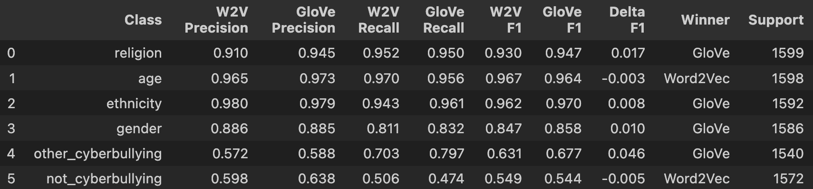

### Transformer model (DistilBERT)
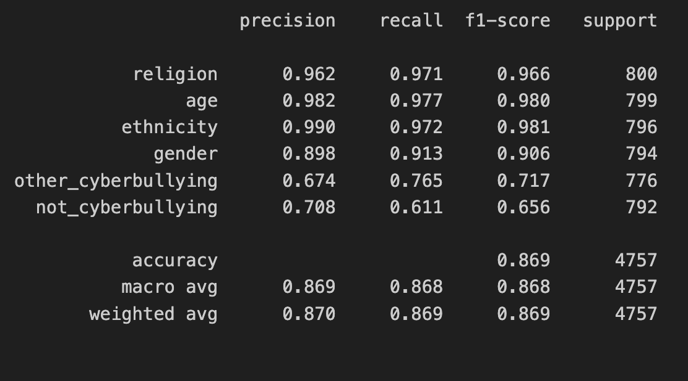

## Training Curves

### BiLSTM (Word2Vec)

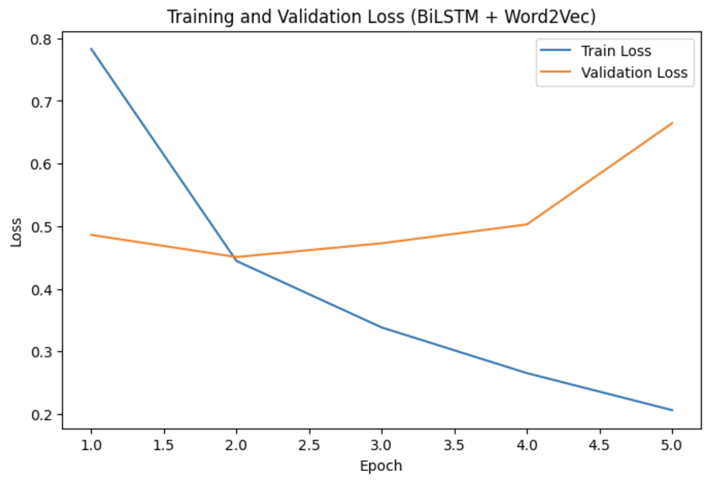

### BiLSTM (GloVe)

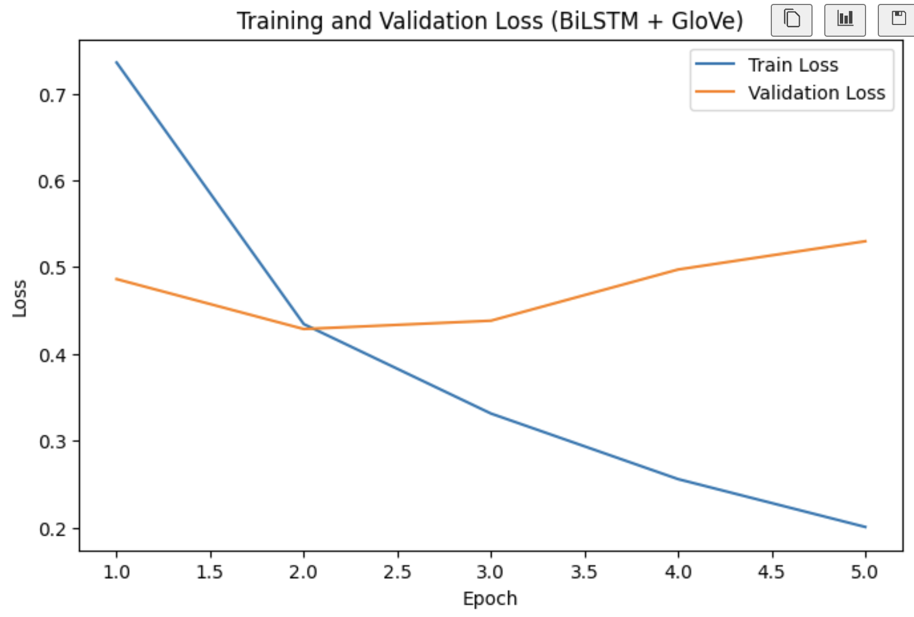

### DistilBERT

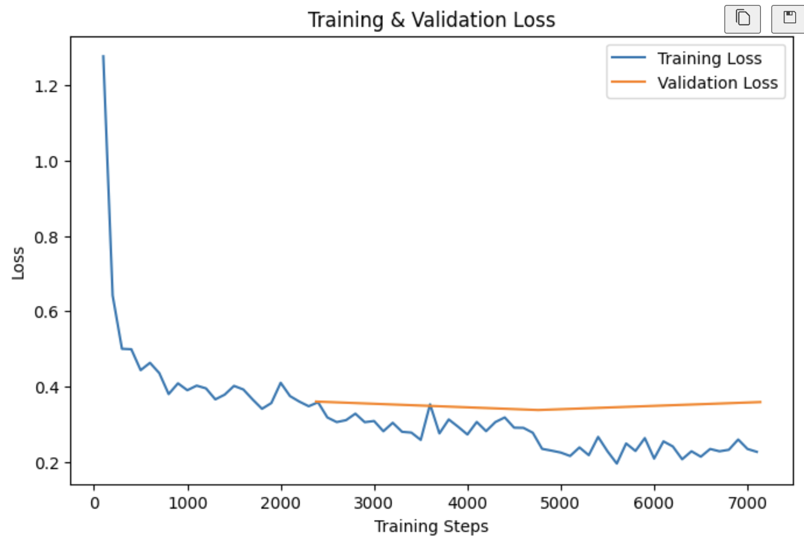

## Confusion Matrices

### Logistic Regression with TF-IDF

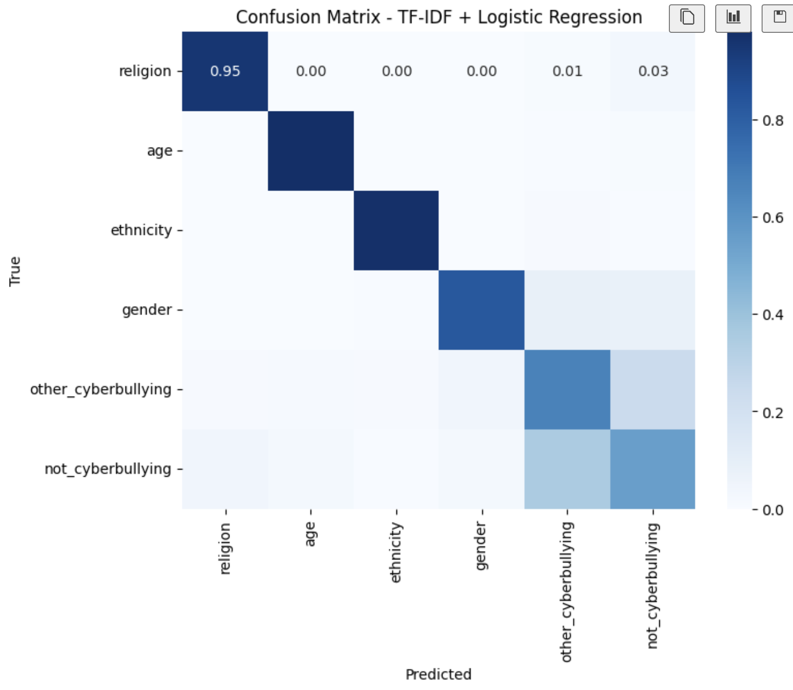

### BiLSTM

#### BiLSTM with Word2Vec
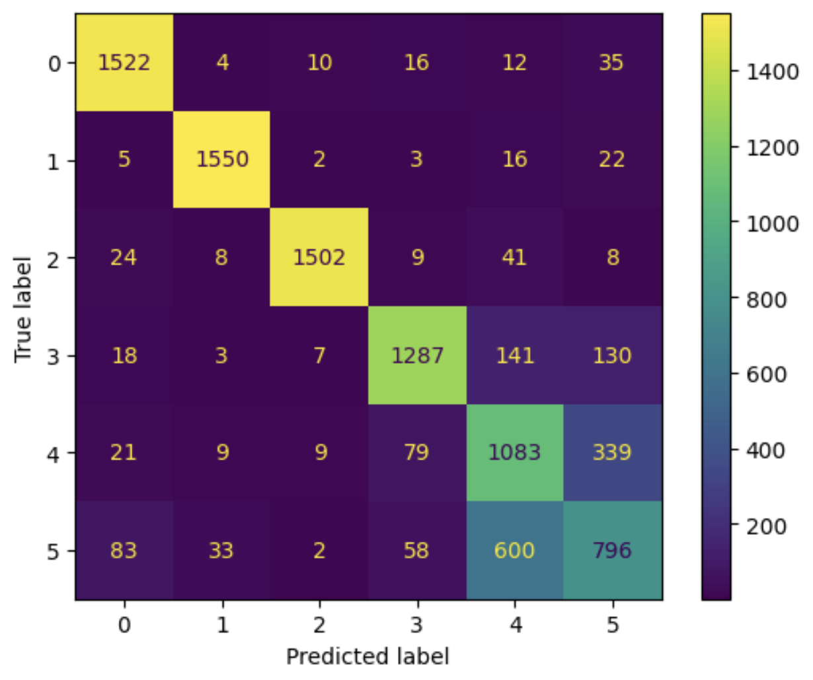

#### BiLSTM with GloVe
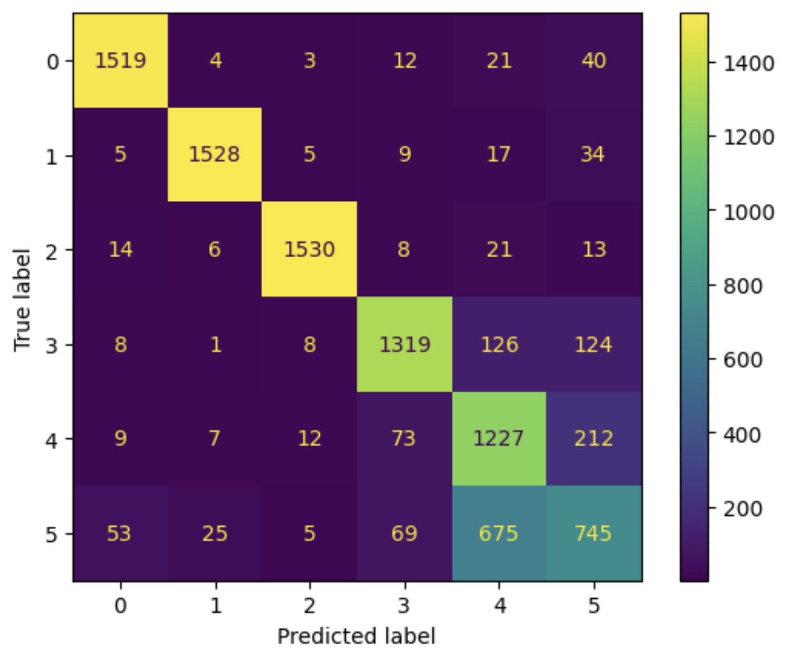

### DistilBERT

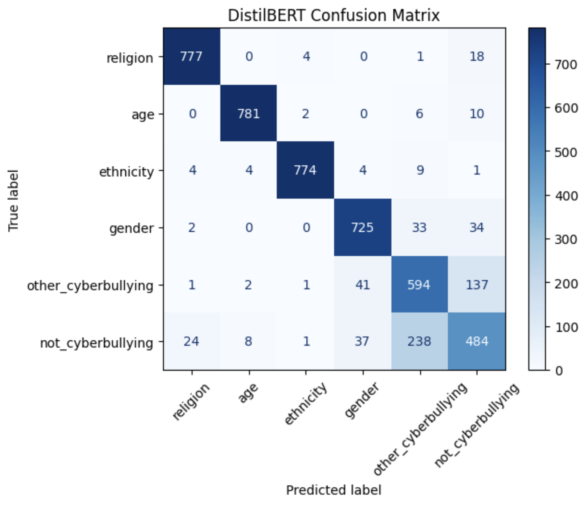

## Tech Stack

- Python
- PyTorch
- Hugging Face Transformers
- Scikit-learn
- Gensim
- Pandas
- NumPy
- Matplotlib
- Seaborn
  
